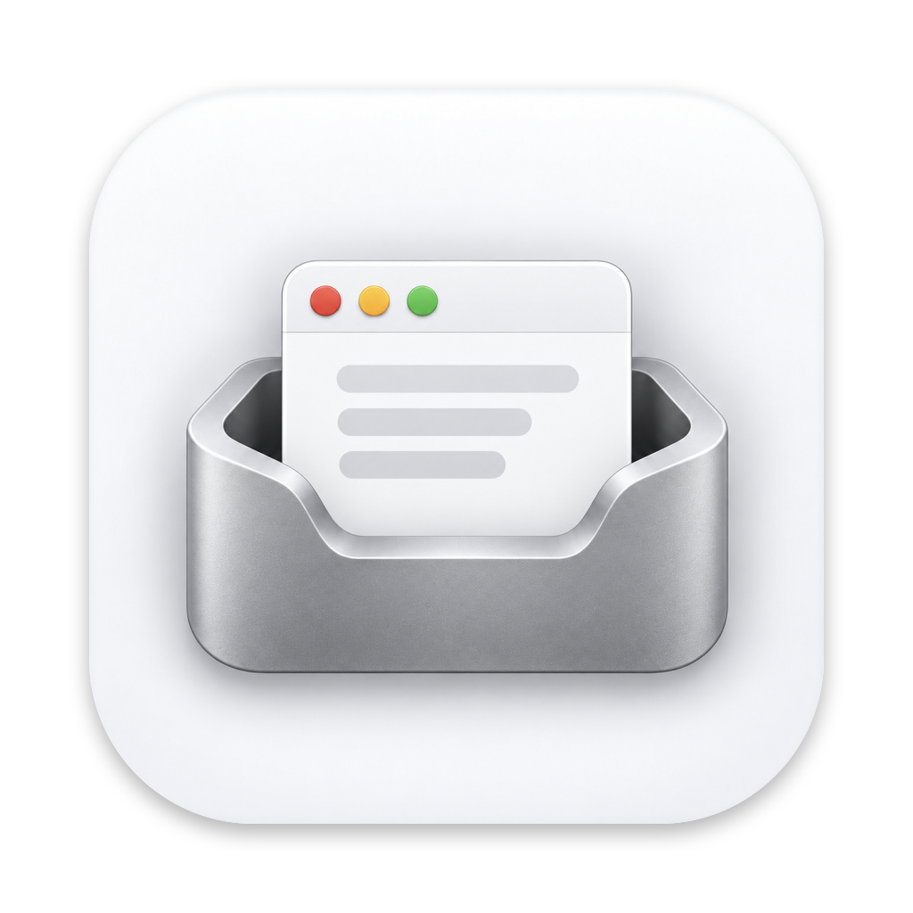

<p align="center">
  
</p>

<h1 align="center">MacBox</h1>

<p align="center">
  把不放心的 Mac 软件装进一个盒子：照常使用，它写下的文件、设置和钥匙串都留在盒子里（「下载」文件夹默认共享，其他例外见下文“限制”）。<br>
  <a href="https://github.com/PykeDLing/macbox/releases/latest"><b>下载最新版</b></a>
</p>

---

各种网盘、下载器、国产工具软件，装上之后往往在系统里到处留东西：开机自启、后台服务、散落各处的缓存和设置。
MacBox 让它们在一个隔离的“盒子”里运行——像普通 App 一样有窗口、在程序坞里，但删掉盒子就干干净净（存进「下载」的文件除外，其他例外见下文“限制”）。

把下载的 `.dmg` 拖进 MacBox 即可，`.app`、`.pkg`、`.zip` 也支持。在线安装器（只有几 MB、打开后再联网下载的那种）也能处理。

## 下载与安装

**系统要求**：Apple Silicon（M 系列芯片）的 Mac，macOS 26 或更新版本。

1. 从 [Releases](https://github.com/PykeDLing/macbox/releases/latest) 下载 `MacBox-<版本>.dmg`
2. 打开 dmg，把 **MacBox** 拖到「应用程序」（Applications）
3. **第一次打开**：MacBox 没有经过 Apple 公证（需要付费开发者账号），macOS 会提示 Apple 无法验证“MacBox”是否包含恶意软件。点「完成」，然后到
   **系统设置 › 隐私与安全性**，在页面底部找到 MacBox，点 **仍要打开**，再输入密码确认。之后就可以正常打开了。

   也可以在终端里去掉下载标记（效果相同）：

   ```bash
   xattr -dr com.apple.quarantine /Applications/MacBox.app
   ```

可以用同目录下的 `.sha256` 文件校验下载是否完整：`shasum -a 256 -c MacBox-<版本>.dmg.sha256`。

> 关于信任：MacBox 本身不在沙盒里运行（它要替盒子里的 App 准备环境、收回设置），所以需要你信任它。不想直接运行下载的二进制文件，可以按[从源码构建](#从源码构建)的步骤自己构建。

## 使用

- **添加应用**：把 `.dmg` / `.app` / `.pkg` / `.zip` 拖进窗口，或点「添加应用」。MacBox 会取出里面的 App（pkg 的安装脚本不会执行），检查它需不需要驱动、系统服务这类本机隔离容纳不了的东西
- **打开**：在 MacBox 里双击，或者从聚焦里打开（MacBox 会放一个同名启动器到 `~/Applications/MacBox`）
- **退出**：MacBox 里的「退出」和 ⌘Q 一样只是请求退出，应用可以先问你要不要存储；几秒后还没退出时，「退出」旁边会多出「强制退出」（「退出」照样可以再点）。退出 MacBox 时会请所有应用退出，等它们收回设置、做完收尾，也等进行中的添加、还原做完；有应用不肯退出时，MacBox 在程序坞里提醒你，等你切回 MacBox 再问强制退出还是取消，不会打断你在应用里存储
- **详情面板**：查看兼容性检查结果和运行报告，切换运行环境，开关联网，管理数据和还原点；MacBox 把应用误认作（或者没认出是）在线安装器时，也在这里改
- **联网开关**：详情面板 › 网络 里关掉「允许联网」，应用就连不上任何服务器（连本机上的代理也不行）、查不了域名，它显示的网页也打不开。适合只想离线用的软件；登录、同步、更新会用不了。下次打开时生效
- **运行报告**：每次在本机隔离中运行，MacBox 都记下这次写了哪些文件、改了哪些设置、连了哪些服务器、启动了哪些程序、哪些行为被拦下，以及哪些设置可能写在了盒子外（可以在报告页里收进盒子，见下文“限制”）。在详情面板里看概要，点「查看完整报告…」看全部；可以拷贝成文字、存储为 Markdown 或图片，或者直接把图片分享出去。路径写成应用眼里的样子（`~/Library/…`），不带你的用户名。每个应用留最近 20 份
- **还原点**：给盒子拍个快照（APFS 克隆，几乎不占空间），之后可以一键回到那个状态，或者设为每次退出自动还原；不需要了可以在详情面板里删除
- **删除**：删除盒子即删除应用和它的全部数据（移到废纸篓，可以找回）。共享「下载」文件夹时（默认），它存进你「下载」里的文件不在盒子里，会保留
- **界面语言**：在 设置 › 语言 里切换简体中文 / English，默认跟随系统

## 卸载

1. 在 MacBox 里删除所有应用（会顺带删掉它们的启动器），退出 MacBox
2. 删除 `/Applications/MacBox.app`
3. 删除数据：`~/Library/Application Support/MacBox/`，以及 `~/Applications/MacBox/`（如果还在）

## 两种运行环境

| | 本机隔离（默认） | 虚拟 Mac（后备） |
| --- | --- | --- |
| 体验 | 原生窗口、程序坞、聚焦，和普通 App 一样 | 一整块独立的 macOS 桌面 |
| 性能 | 原生（沙盒开销约 1.5%） | 接近原生，默认分配 4–8 GB 内存（可调整） |
| 空间 | 只有应用本身和它的数据 | 约 30 GB，所有需要它的应用共用一台 |
| 适用 | 绝大多数应用 | 需要驱动、系统服务、系统扩展的应用 |

虚拟 Mac 不会默认安装。添加应用时，静态检查发现它需要驱动、特权辅助程序、系统扩展、网络扩展；或者运行时它被挡住了写系统目录、安装系统服务，MacBox 会建议改用虚拟 Mac（运行时的这类拦截，你选了「继续使用本机隔离」之后，同样的拦截不再询问）。拖进来的安装包里只有驱动、插件这类系统组件、没有能单独运行的 App 时，MacBox 会提出把它放进虚拟 Mac 安装。你也可以在详情面板里随时切换。处理方式在 设置 › 兼容性 里选择：询问我，或者自动改用虚拟 Mac。

## 本机隔离是怎么做到的

| 手段 | 作用 |
| --- | --- |
| Seatbelt 沙盒（`sandbox-exec`），子进程自动继承 | 写操作默认全部禁止，只放行盒子里 App 的主目录、App 本身、临时目录和你的「下载」文件夹（默认共享，App 能在里面新建、修改、删除文件；可在详情面板里按应用关闭）。盒子里 MacBox 自己的记录（借出日志、本机设置的备份、钥匙串密码、还原点）App 既改不了也读不到。也禁止读取邮件、信息、Safari、Cookie、iCloud 云盘、其他 App 的数据（Application Support、容器、缓存、WebKit 网站数据），以及 SSH、GPG、AWS、Kubernetes 的密钥和 `~/.config`、`~/.netrc`、`~/.git-credentials`、`~/.docker` 等处命令行工具的凭证。禁止注册登录项和后台服务、发送通知、用 Apple 事件控制其他 App |
| 重定向主目录（`HOME` + `CFFIXED_USER_HOME`） | App 的 Application Support、Caches、Cookies 都落在盒子里 |
| 每个盒子一个独立钥匙串 | 主目录里的 `login.keychain-db` 指向盒子钥匙串，凭证和设备 ID 不进你的「登录」钥匙串 |
| 偏好设置“借出再收回” | cfprefsd 代写的 UserDefaults 沙盒挡不住，所以启动前把系统里这些域**整体替换**为盒子的内容，退出后完整收回、再把本机原来的内容整体换回。按事务处理：先写日志 `Prefs/.lease.json` 再动系统，中途失败立即回滚，MacBox 崩溃后下次启动按日志恢复 |
| 运行时守卫 | MacBox 打开期间每 50ms 检查新进程、每 0.5 秒复查一次（先启动系统程序再 exec 成盒子里的程序的也查得到）：可执行文件或解释器运行的脚本位于盒子或盒子挂载的卷上的，必须在沙盒中、且属于 MacBox 登记过的运行会话，否则立即结束（例如被系统直接启动、自带苹果沙盒的 App 从程序坞打开、MacBox 崩溃后遗留的进程）。进程属于哪个会话，在第一次看到它时按进程组、父进程或负责进程认定并记住，会话里的进程一派生就记下新进程，所以会话主进程退出后留下的辅助进程照常运行 |
| App 平时上锁 | 盒子里 App 包内的程序平时没有执行权限，MacBox 启动它之前一刻才加回，所有进程退出后再去掉。MacBox 没在运行时，从程序坞、聚焦或者登录时自动重新打开都启动不了它，不会在沙盒外运行 |
| 不联网（可选） | 挡住应用的所有 IP 连接（包括连到本机回环地址：系统设置了代理时，应用会先连本机上的代理端口）、等别人连进来、找 mDNSResponder 解析域名；也不许它启动替 WKWebView 联网的 WebKit 网络进程、替后台下载的 nsurlsessiond——它们不在盒子的沙盒里，只挡应用自己的话网页照样打得开 |
| 运行报告 | 文件：启动前记下主目录、App 里每个文件的大小、修改时间，退出后对比，按位置汇总；共享的「下载」不去读，沙盒规则在应用每次写它时在系统日志里记一笔。设置：对比盒子里存的偏好设置，只记键名不记内容。程序：同样由沙盒规则在放行时记一笔。连接：运行中定时用 `nettop` 看一次会话进程（包括替它联网的 WebKit 网络进程）的连接，刚启动时每半秒一次，之后逐渐放慢到每 3 秒，公网地址反向解析名字。报告存在盒子的 `Reports/` 里，App 读不到也改不了 |
| 在线安装器 | 禁止它挂载磁盘映像，以免它从卷上在沙盒外启动 App。它下载的完整安装包由 MacBox 取出 App 完成安装，然后打开（需要虚拟 Mac 的先询问） |
| 启动器 | `~/Applications/MacBox` 里放一个同名同图标的启动器，从聚焦打开时经由 MacBox 在隔离中启动，并把它切到前台 |
| 崩溃也能收拾 | 还原、清除数据、更新还原点、安装器接手时替换 App，每一项都先在旁边准备好再整体换上；还原和清除数据开始前还会留下标记，做到一半失败或者 MacBox 中途崩溃时，下次打开这个应用前、下次启动 MacBox 时把它重做一遍，不在一半新一半旧的数据上运行。MacBox 中途崩溃、被强制退出时，下次启动会把做到一半的替换改回原样，结束遗留的程序（不记成逃逸、不自动重新打开），收回偏好设置，重新锁上 App |

每次启动时生成的沙盒规则会保存在盒子里的 `sandbox.sb`，方便排查。

**限制**：本机隔离防的是“乱写、乱留、乱读”，不是恶意软件。它与本机共用内核和用户身份，来路可疑的软件请用虚拟 Mac。被挡住的功能包括开机自启、通知、访达扩展、需要驱动的功能。具体还有：

- MacBox 没开时没有守卫，绕过 MacBox 直接打开盒子里的 App 只靠「App 平时上锁」挡住。MacBox 运行中异常退出时，App 会一直保持可执行，直到下次打开 MacBox 才重新上锁
- 被拦下的行为和启动的程序来自系统日志，是**尽力而为**的记录：内核对沙盒报告做全局限流和去重，其他进程报告很多时盒子里的会被丢弃。没有记录不代表没有被拦截
- 运行报告里的连接是定时看一眼得到的，开始又结束得很快的连接会漏掉；日志里看不到对方的域名，服务器名字来自反向解析，常常是云服务商的机器名。设置了代理时，经由代理的连接只显示为连到本机的代理端口，用代理的“虚拟 IP”模式时只看得到虚拟地址
- 运行报告不统计 `/private/tmp`、`/private/var/folders`（所有程序共用，分不出是谁写的）。共享的「下载」MacBox 不去读（那要你授权），应用在里面写了什么来自系统日志，同样会漏记，也没有大小
- 不联网挡不住由系统代办的事：让你的默认浏览器打开一个网址（网址里可以带数据）、iCloud 同步、推送通知等
- `/private/tmp` 和 `/private/var/folders` 可写（很多系统框架依赖它们），App 可以在这里留下文件
- 读取只挡住上面列出的这几类私人数据，别处沙盒都不挡，例如文稿、桌面
- 其他 App 的偏好设置读得到：`~/Library/Preferences` 里的文件沙盒不挡，经由 cfprefsd 读取也不受沙盒约束
- 偏好设置只借出、收回按 bundle ID 认定属于这个 App 的域，而且不含 ByHost 设置。“仅限本机”的 ByHost 设置（`~/Library/Preferences/ByHost`，App 自己的也算），以及认定范围以外的域（厂商的更新程序、第三方 SDK、App Group 共享设置等），App 读到的是本机的内容，写入也直接落在你真实的 `~/Library/Preferences`。运行报告的「可能属于这个应用、但写在了盒子外的设置」一栏会列出运行期间新出现的这两类设置：认定范围以外的域可以在报告页里确认后「收进盒子」（现在的内容存进盒子、从本机删除，之后和 App 自己的设置一样只在运行时借出）；ByHost 设置只列出，收不进来。没有收进来的，删除盒子后仍然留着
- 这一栏是对比运行前后的 `~/Library/Preferences` 得出的，不是确凿的记录：偏好设置由系统服务替所有程序代写，分不出是谁写的，同一时间别的程序新建的也会列进来；运行前就已存在、运行中被它改写的域看不出来。MacBox 不会自动挪动或删除它们。收进盒子的域如果其实也被这台 Mac 上的别的程序用着，那个程序之后就读不到这些设置了；整个厂商的名字（如 `com.example`）、和这台 Mac 上装着的其他 App 或别的盒子重叠的不能收
- 同一个应用的两份（两个盒子，或者盒子和直接装在这台 Mac 上的那份）共用一组偏好设置，不能同时运行：打开盒子时另一份正在运行，MacBox 会拒绝并告诉你先退出哪一个。盒子运行期间再去打开本机的那份拦不住，请避免。自带苹果沙盒的版本（例如 App Store 版）用自己的设置，不受影响
- 用 Data Protection 钥匙串（`kSecUseDataProtectionKeychain`）的 App，钥匙串条目不会进盒子钥匙串
- App 包内的 XPC 服务由系统直接启动、不在沙盒中，会被守卫结束，依赖它们的功能不可用

## 从源码构建

需要 Apple Silicon Mac、macOS 26 及以上、Swift 6.4 及以上（Xcode 27 或对应的 Command Line Tools；代码用到了 `defer` 中的 `await`）。只装了 Command Line Tools 也能构建：

```bash
./build.sh
open build/MacBox.app
```

`build.sh` 直接调用 `swiftc`，会自动选择与编译器匹配的 SDK，然后用 `com.apple.security.virtualization` entitlement 做 ad-hoc 签名。

测试（Swift Testing，会真实地启动沙盒进程、创建钥匙串、读系统日志、挂载 dmg、读写偏好设置，但只用临时目录和 `dev.macboxtest.` 开头的测试域，不碰你的盒子）：

```bash
MACBOX_DATA_ROOT=$(mktemp -d) swift test --no-parallel
```

- 打开盒子、运行时守卫、启动器这类生命周期测试要用到 MacBox 的数据目录，只在设置了 `MACBOX_DATA_ROOT` 时运行，否则跳过
- 要加 `--no-parallel`（全部跑完约两分钟）：这些测试用的都是真实的系统服务，并行时互相拖慢，按时间判断的测试（会话、守卫、子进程）会因为等不到而失败

想在不影响真实数据的情况下手动试用，可以把全部数据（含启动器）放到别处：`open -n build/MacBox.app --env MACBOX_DATA_ROOT=/tmp/macbox-test`。

图标：原图是 `Resources/icon/AppIcon-source.png`，`Resources/icon/make_icns.sh` 会去掉白底、裁成 macOS 图标网格并生成 `Resources/AppIcon.icns`。

打包发布用的 dmg（release 构建 + Applications 快捷方式 + 卷图标，输出到 `dist/`，并生成 `.sha256`）：

```bash
./scripts/package-dmg.sh
```

版本号在 `Resources/Info.plist` 的 `CFBundleShortVersionString`。

## 架构要点

- **进程**：`ChildProcess` 是启动子进程的唯一入口。子进程只继承 0/1/2（`POSIX_SPAWN_CLOEXEC_DEFAULT`）；输出用 DispatchIO 读取，不在 Swift 并发线程池里阻塞；退出由 kqueue 进程源通知。`Shell` 只是它的薄封装
- **系统状态是借来的**：偏好设置借出、钥匙串搜索列表、挂载的卷、LaunchServices 登记，都按“先记录、可重做、必归还”处理
- **会话是结构化的**：`IsolatedSession.run` 从准备到收尾是一个 async 函数，每借一样东西紧接着 `defer` 归还，失败、取消都按相反顺序归还
- **状态集中**：盒子只有一个 `activity` 状态（空闲 / 启动中 / 运行中 / 收尾中 / 维护中），“能不能做某事”都从它推出
- **共享的系统事件**：整个 MacBox 只开一个 `log stream`，按盒子分发；守卫只认登记过的会话

## 目录结构

```
Sources/MacBox/
  App/          入口、窗口、URL（macbox://open/<id>）与文件打开
  Core/         路径、文件操作、子进程（ChildProcess）、命令行、进程表
  Box/          盒子模型、导入（dmg/pkg/zip/app 取出 App）、兼容性检查、运行报告
  Isolation/    沙盒规则、盒子钥匙串、偏好设置收回、拦截记录、连接采样、守卫、运行会话、启动器
  VirtualMac/   虚拟 Mac（Virtualization.framework）
  Views/        SwiftUI 界面
Resources/icon/ 图标原图与生成脚本（AppIcon-source.png → make_icns.sh）
Tests/          Swift Testing 测试
scripts/        打包发布（package-dmg.sh）
```

数据位置：`~/Library/Application Support/MacBox/`

- `Boxes/<uuid>.box`：每个应用一个盒子，包含 `App/`、`Home/`、`Prefs/`、`Source/`、还原点和运行报告（`Reports/`）
- `VirtualMac/`：虚拟 Mac
- `RestoreImages/`：macOS 安装镜像缓存（设置完成后可在侧边栏「虚拟 Mac」页的“占用空间”里删除）

## 许可证

[MIT](LICENSE)
